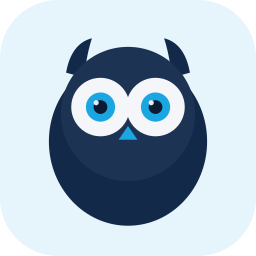
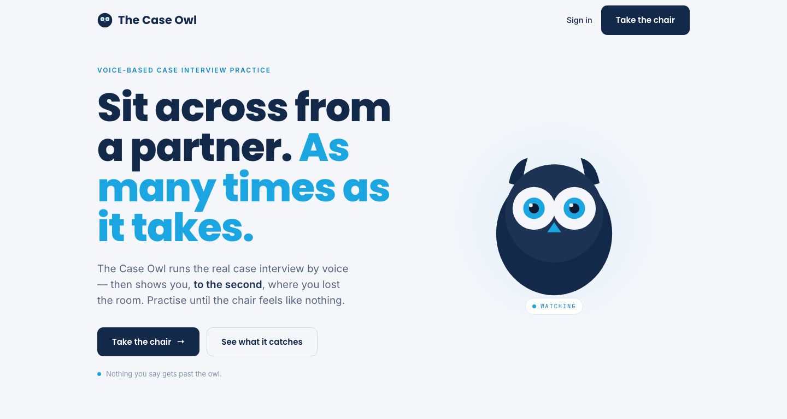
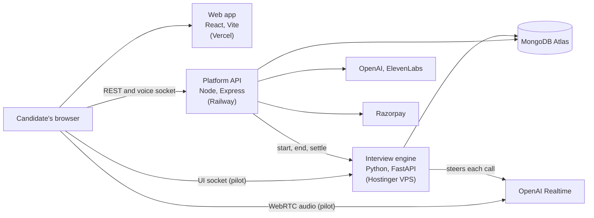

<div align="center">



# The Case Owl

**Sit across from a partner. As many times as it takes.**

Voice-based case interview practice. An AI interviewer runs the real interview out loud,<br>
then shows you, to the second, where you lost the room.

[**thecaseowl.com**](https://thecaseowl.com) · [Playbook](docs/PLAYBOOK.md) · [Status](docs/STATUS.md) · [Product context](docs/the-case-owl-context.md)


<br>



</div>

---

## Why The Case Owl

A handful of interviews decide years of a consulting or product career, and there are no second takes.

| ~1% | 3–4 | 0 |
|:---:|:---:|:---:|
| acceptance rate at the top firms | interviews, total | do-overs |

Real case practice is scarce and expensive, and friends are too polite to help: "that was great". The
Case Owl gives candidates unlimited realistic reps with an interviewer who leads like a real one, and
feedback that names the exact thing holding them back.

Built for MBA and pre-MBA candidates preparing for consulting, product and market-sizing interviews,
with India as the primary market.

## How it works

| | Step | What happens |
|:---:|---|---|
| **1** | **Pick the interview** | A consulting case (profitability, market entry, M&A, pricing and more), a product interview, a guesstimate, or one built from your own resume. Set the difficulty and the interviewer's style |
| **2** | **Take the chair** | Talk it through out loud, in the browser. The interviewer presents the case, answers what you ask, probes weak spots and reveals exhibits when you earn them. Capped at 30 minutes |
| **3** | **See where you lost the room** | A report with your grade, a case map of what you found and missed, timestamped moments the owl caught, and the one thing to fix first |
| **4** | **Close the gap** | Micro-lessons tied to your recurring mistakes, company-specific preparation, and a dashboard that tracks your readiness |

## What the owl catches

Nothing you say gets past the owl. Every report points at moments like these:

> `02:08` load-bearing assumption never validated · `05:41` no hypothesis before the math ·
> `11:20` recommendation without a number · "like" × 9 · 116 wpm

It looks for missed structure, weak frames, unvalidated numbers, rushed math, vague recommendations,
filler words and the pauses that cost you, and scores each interview on three pillars: **navigation**
(how well you worked through the case map), **structure** and **communication**.

## Features

| Area | What the candidate gets |
|---|---|
| **Live interviews** | Consulting cases with exhibits and quant tasks, product interviews (design, strategy, root cause, prioritisation), guesstimates, and resume-based interviews. Supportive, neutral or stress-test interviewers |
| **Reports** | Overall grade and percentile, a three-pillar score, a case map, timestamped "caught" moments, pace and filler stats, strengths, and an ideal transcript of the same case |
| **Preparation** | Micro-lessons tied to recurring mistakes, frameworks per case type, a company preparation hub, and a progress dashboard |
| **Billing** | Plans and a credit wallet (1 credit = 1 interview minute), paid through Razorpay |

---

## For developers

- [Architecture](#architecture)
- [Repository layout](#repository-layout)
- [Getting started](#getting-started)
- [Checks and tests](#checks-and-tests)
- [Deployment](#deployment)
- [Documentation](#documentation)
- [Working with Claude Code](#working-with-claude-code)
- [Contributing](#contributing)

### Architecture

Three services share one repository.



- **Platform API** (`server/`): accounts, cases, sessions, reports, coaching, billing, and the
  speech → model → speech voice pipeline that most interviews run on today.
- **Web app** (`src/`): the candidate-facing app, served by Vercel, which forwards `/api` to Railway.
- **Interview engine** (`engine/`): the next-generation interviewer for consulting cases, in pilot.
  Audio flows directly between the browser and OpenAI over WebRTC; the engine steers each call, owns
  turn-taking, releases case facts one at a time, and hands the transcript back to the platform. Design:
  [docs/interview-engine-architecture.md](docs/interview-engine-architecture.md). Contract between the
  two services: [docs/engine-contract.md](docs/engine-contract.md).

### Repository layout

| Path | What it is |
|---|---|
| `server.ts`, `server/` | Platform API: `config/`, `middleware/`, `models/` (Mongoose), `ai/` (prompts and model calls), `modules/<feature>/` (routes, controllers, services) |
| `src/` | Web app: `pages/`, `components/`, `features/` (self-contained features such as the dashboard), `hooks/`, `lib/` |
| `engine/` | Interview engine: `app/` (service), `cases/` (case fact trees), `tests/`, `tools/` (evals, benchmarks, schema export), `deploy/` |
| `scripts/` | One-off operational scripts. Most reach real APIs or the production database |
| `docs/` | Product context, engine design and contract, status, specs, the playbook, brand assets |
| `CLAUDE.md`, `.claude/` | The team's shared Claude Code setup (see [Working with Claude Code](#working-with-claude-code)) |
| `server 2 - dd/` | An experimental second backend; not part of the running product |

### Getting started

**Prerequisites**

- Node.js 20 or later (`.nvmrc`), with npm
- [uv](https://docs.astral.sh/uv/) and Python 3.12, for the interview engine
- A MongoDB database for development. Use a local one; the shared Atlas cluster is production

```bash
docker run -d -p 27017:27017 --name case-owl-mongo mongo:7
```

**Install**

```bash
npm install
```
```bash
cd engine && uv sync
```

**Configure.** Copy `.env.example` to `.env` and fill in the values. Never commit `.env`.

| Variable | Needed for |
|---|---|
| `MONGODB_URI` | Required. For local development: `mongodb://localhost:27017/case-owl` |
| `JWT_SECRET` | Sign-in tokens. Any long random string locally; a real secret in production |
| `OPENAI_API_KEY` | Interviews, case generation, reports |
| `ELEVENLABS_API_KEY` | The interviewer's voice on the current voice pipeline |
| `RAZORPAY_KEY_ID`, `RAZORPAY_KEY_SECRET`, `RAZORPAY_WEBHOOK_SECRET` | Billing. Use test keys locally |
| `ENGINE_URL`, `ENGINE_SERVICE_TOKEN`, `NODE_INTERNAL_TOKEN` | Optional: routes pilot users' interviews to the interview engine |
| `FRONTEND_URL`, `APP_URL` | CORS and links; defaults suit local development |

The full list, with defaults, is validated in `server/config/env.ts`. Frontend-only settings go in
`.env.local`: `API_PROXY_TARGET` points the dev server at another backend (pointing it at production
means real data and real payments), and `VITE_DASHBOARD_SOURCE=api` switches the dashboard from mock
data to the API.

**Run** the platform API and the web app, in two terminals:

```bash
npm run server:dev
```
```bash
npm run dev
```

The app is at http://localhost:5173; it forwards `/api`, including the voice socket, to the API on
port 5050. A new database starts with the plans seeded and no cases; add cases from the app (generate
one, or upload your own).

The interview engine runs from `engine/`, in two terminals (it reads `OPENAI_API_KEY` from the repo's
`.env`):

```bash
uv run uvicorn app.main:app --port 8780
```
```bash
uv run python tools/node_stub.py
```

Then open http://localhost:5051 in Chrome, with headphones. Without `MONGO_URI` the engine keeps
everything in memory. More in [engine/README.md](engine/README.md).

### Checks and tests

| Check | Command | Notes |
|---|---|---|
| Type check | `npm run lint` | `tsc --noEmit`. 11 known errors are tracked in `.claude/hooks/tsc-baseline.json`; add none |
| Build | `npm run build` | Vite production build to `dist/` |
| Engine tests | `cd engine && uv run pytest -q` | About 110 tests in under 10 seconds, no network |
| Engine behaviour evals | `cd engine && uv run python tools/evals.py --runs 5` | Runs 16 interview scenarios against the real models. Costs money |

The platform API has no automated test suite yet.

### Deployment

| Service | Host | Deploys |
|---|---|---|
| Web app | Vercel ([thecaseowl.com](https://thecaseowl.com)) | Builds every push to `main` |
| Platform API | Railway | Builds from `main` (Nixpacks, `npm ci`), only when its own files change. A deploy drops live voice interviews |
| Interview engine | Hostinger VPS, Mumbai | From `main`, on a click: Actions → Engine deploy → Run workflow (runs `engine/deploy/deploy.sh`: Docker Compose behind Caddy). Live interviews survive a deploy |

`main` is production; work comes together on `develop` first. CI (`.github/workflows/ci.yml`) runs
the type check, the build and the engine tests on every pull request. Secrets are set in each host's dashboard or, for the engine, with
`engine/deploy/push-secrets.sh`; none are in the repository.

### Documentation

| Document | Covers |
|---|---|
| [docs/STATUS.md](docs/STATUS.md) | What is live, in progress and open; decisions waiting to be made |
| [docs/PLAYBOOK.md](docs/PLAYBOOK.md) | How the team works: the loop, worked examples, recipes, hard rules |
| [docs/the-case-owl-context.md](docs/the-case-owl-context.md) | The product: users, journey, pricing, stack, design identity |
| [docs/interview-engine-architecture.md](docs/interview-engine-architecture.md) | Interview engine design, dated decisions, what is verified |
| [docs/engine-contract.md](docs/engine-contract.md) | The API, callback and socket contract between the engine and the platform |
| [engine/README.md](engine/README.md) | Running, testing, evaluating and deploying the engine |
| [docs/specs/](docs/specs/) | One design spec per significant change, with what was actually built |
| [src/features/dashboard/README.md](src/features/dashboard/README.md) | The dashboard feature and its backend contract |

### Working with Claude Code

The repository carries a shared [Claude Code](https://claude.com/claude-code) setup, so every session
follows the same process and guardrails:

- [CLAUDE.md](CLAUDE.md), loaded in every session: the map, where the truth lives, the working loop and
  the hard rules.
- `.claude/`: rules per area, slash commands (`/spec`, `/check`, `/review-diff`, `/ship`, …),
  reviewer agents, and hooks that guard secrets, production and the answer key.

Start with the [playbook](docs/PLAYBOOK.md). Every command, agent and hook is described in the
[setup reference](.claude/README.md).

### Contributing

- Work on a `<scope>/<slug>` branch off `develop` and open a pull request into `develop`; CI runs on it.
  A release is a pull request from `develop` to `main` (production). A hotfix is a `hotfix/<slug>`
  branch off `main`. The full model is in the [playbook](docs/PLAYBOOK.md), section 9.
- Bring your branch up to date with `develop` before starting and before shipping.
- Commits follow [Conventional Commits](https://www.conventionalcommits.org/) with a scope:
  `feat(engine): …`, `fix(ui): …`, `chore(dev): …`.
- Significant changes start with a spec in `docs/specs/`. Docs are updated in the same change as the
  code they describe.
- Never commit secrets, and never expose case answers to the browser during an interview.

---

<div align="center">


**Nothing you say gets past the owl.**

Built by Himanshu Parihar, Dhrumil Daftary and Paritosh Sharma.

</div>
