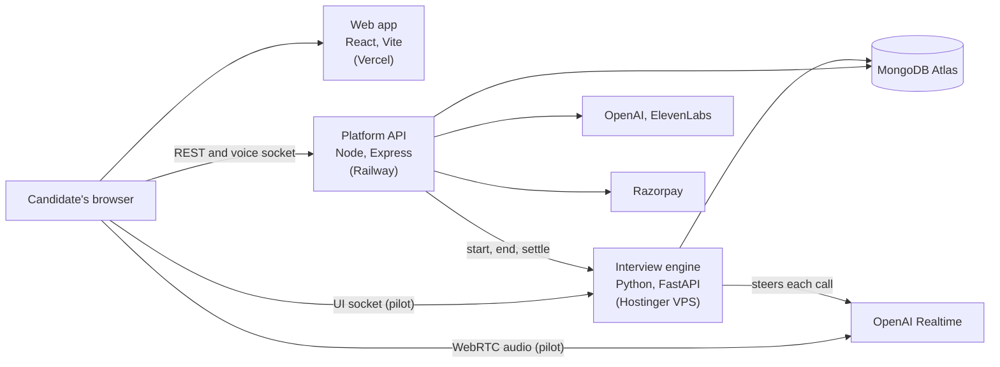

# The Case Owl

**Voice-based case interview practice.** A candidate talks out loud with an AI interviewer that runs a
realistic consulting, product or market-sizing interview, then gets a blunt, timestamped report showing
where they lost the room and the one thing to fix first.

Built for MBA and pre-MBA candidates preparing for consulting and product interviews, with India as the
primary market. Live at [thecaseowl.com](https://thecaseowl.com).

| | |
|---|---|
| **Status** | Live; interview engine in pilot. Current state: [docs/STATUS.md](docs/STATUS.md) |
| **How we work** | [docs/PLAYBOOK.md](docs/PLAYBOOK.md): the working loop, worked examples, recipes |
| **Product context** | [docs/the-case-owl-context.md](docs/the-case-owl-context.md) |

---

## Contents

- [What it does](#what-it-does)
- [Architecture](#architecture)
- [Repository layout](#repository-layout)
- [Getting started](#getting-started)
- [Checks and tests](#checks-and-tests)
- [Deployment](#deployment)
- [Documentation](#documentation)
- [Working with Claude Code](#working-with-claude-code)
- [Contributing](#contributing)

## What it does

| Area | What the candidate gets |
|---|---|
| **Live interviews** | Consulting cases (profitability, market entry, M&A, pricing and more), product interviews (design, strategy, root cause, prioritisation), guesstimates, and interviews based on the candidate's own resume. Spoken, in the browser, capped at 30 minutes |
| **Reports** | Overall grade and percentile, a three-pillar score (navigation, structure, communication), a case map of what was found and missed, timestamped "caught" moments, pace and filler stats, and an ideal transcript |
| **Preparation** | Micro-lessons tied to recurring mistakes, frameworks per case type, a company preparation hub, and a dashboard of progress and readiness |
| **Billing** | Plans and a credit wallet (1 credit = 1 interview minute), paid through Razorpay |

## Architecture

Three services share one repository.



- **Platform API** (`server/`): accounts, cases, sessions, reports, coaching, billing, and the
  speech → model → speech voice pipeline that most interviews run on today.
- **Web app** (`src/`): the candidate-facing app, served by Vercel, which forwards `/api` to Railway.
- **Interview engine** (`engine/`): the next-generation interviewer for consulting cases, in pilot.
  Audio flows directly between the browser and OpenAI over WebRTC; the engine steers each call, owns
  turn-taking, releases case facts one at a time, and hands the transcript back to the platform. Design:
  [docs/interview-engine-architecture.md](docs/interview-engine-architecture.md). Contract between the
  two services: [docs/engine-contract.md](docs/engine-contract.md).

## Repository layout

| Path | What it is |
|---|---|
| `server.ts`, `server/` | Platform API: `config/`, `middleware/`, `models/` (Mongoose), `ai/` (prompts and model calls), `modules/<feature>/` (routes, controllers, services) |
| `src/` | Web app: `pages/`, `components/`, `features/` (self-contained features such as the dashboard), `hooks/`, `lib/` |
| `engine/` | Interview engine: `app/` (service), `cases/` (case fact trees), `tests/`, `tools/` (evals, benchmarks, schema export), `deploy/` |
| `scripts/` | One-off operational scripts. Most reach real APIs or the production database |
| `docs/` | Product context, engine design and contract, status, specs, the playbook |
| `CLAUDE.md`, `.claude/` | The team's shared Claude Code setup (see [Working with Claude Code](#working-with-claude-code)) |
| `server 2 - dd/` | An experimental second backend; not part of the running product |

## Getting started

### Prerequisites

- Node.js 20 or later (`.nvmrc`), with npm
- [uv](https://docs.astral.sh/uv/) and Python 3.12, for the interview engine
- A MongoDB database for development. Use a local one; the shared Atlas cluster is production

```bash
docker run -d -p 27017:27017 --name case-owl-mongo mongo:7
```

### Install

```bash
npm install
```
```bash
cd engine && uv sync
```

### Configure

Copy `.env.example` to `.env` and fill in the values. Never commit `.env`.

| Variable | Needed for |
|---|---|
| `MONGODB_URI` | Required. For local development: `mongodb://localhost:27017/case-owl` |
| `JWT_SECRET` | Sign-in tokens. Any long random string locally; a real secret in production |
| `OPENAI_API_KEY` | Interviews, case generation, reports |
| `ELEVENLABS_API_KEY` | The interviewer's voice on the current voice pipeline |
| `RAZORPAY_KEY_ID`, `RAZORPAY_KEY_SECRET`, `RAZORPAY_WEBHOOK_SECRET` | Billing. Use test keys locally |
| `ENGINE_URL`, `ENGINE_SERVICE_TOKEN`, `NODE_INTERNAL_TOKEN` | Optional: routes pilot users' interviews to the interview engine |
| `FRONTEND_URL`, `APP_URL` | CORS and links; defaults suit local development |

The full list, with defaults, is validated in `server/config/env.ts`. Frontend-only settings go in
`.env.local`: `API_PROXY_TARGET` points the dev server at another backend (pointing it at production
means real data and real payments), and `VITE_DASHBOARD_SOURCE=api` switches the dashboard from mock
data to the API.

### Run

Platform API and web app, in two terminals:

```bash
npm run server:dev
```
```bash
npm run dev
```

The app is at http://localhost:5173; it forwards `/api`, including the voice socket, to the API on
port 5050. A new database starts with the plans seeded and no cases; add cases from the app (generate
one, or upload your own).

Interview engine, from `engine/`, in two terminals (it reads `OPENAI_API_KEY` from the repo's `.env`):

```bash
uv run uvicorn app.main:app --port 8780
```
```bash
uv run python tools/node_stub.py
```

Then open http://localhost:5051 in Chrome, with headphones. Without `MONGO_URI` the engine keeps
everything in memory. More in [engine/README.md](engine/README.md).

## Checks and tests

| Check | Command | Notes |
|---|---|---|
| Type check | `npm run lint` | `tsc --noEmit`. 11 known errors are tracked in `.claude/hooks/tsc-baseline.json`; add none |
| Build | `npm run build` | Vite production build to `dist/` |
| Engine tests | `cd engine && uv run pytest -q` | About 110 tests in under 10 seconds, no network |
| Engine behaviour evals | `cd engine && uv run python tools/evals.py --runs 5` | Runs 16 interview scenarios against the real models. Costs money |

The platform API has no automated test suite yet.

## Deployment

| Service | Host | Deploys |
|---|---|---|
| Web app | Vercel ([thecaseowl.com](https://thecaseowl.com)) | Builds from `main` |
| Platform API | Railway | Builds from `main` (Nixpacks). A deploy drops live voice interviews |
| Interview engine | Hostinger VPS, Mumbai | By hand with `engine/deploy/deploy.sh`: Docker Compose behind Caddy. Live interviews survive a deploy |

`main` is production. Secrets are set in each host's dashboard or, for the engine, with
`engine/deploy/push-secrets.sh`; none are in the repository.

## Documentation

| Document | Covers |
|---|---|
| [docs/STATUS.md](docs/STATUS.md) | What is live, in progress and open; decisions waiting to be made |
| [docs/PLAYBOOK.md](docs/PLAYBOOK.md) | How the team works: the loop, worked examples, recipes, hard rules |
| [docs/the-case-owl-context.md](docs/the-case-owl-context.md) | The product: users, journey, pricing, stack, design identity |
| [docs/interview-engine-architecture.md](docs/interview-engine-architecture.md) | Interview engine design, dated decisions, what is verified |
| [docs/engine-contract.md](docs/engine-contract.md) | The API, callback and socket contract between the engine and the platform |
| [engine/README.md](engine/README.md) | Running, testing, evaluating and deploying the engine |
| [docs/specs/](docs/specs/) | One design spec per significant change, with what was actually built |
| [src/features/dashboard/README.md](src/features/dashboard/README.md) | The dashboard feature and its backend contract |

## Working with Claude Code

The repository carries a shared [Claude Code](https://claude.com/claude-code) setup, so every session
follows the same process and guardrails:

- [CLAUDE.md](CLAUDE.md), loaded in every session: the map, where the truth lives, the working loop and
  the hard rules.
- `.claude/`: rules per area, slash commands (`/spec`, `/check`, `/review-diff`, `/ship`, …),
  reviewer agents, and hooks that guard secrets, production and the answer key.

Start with the [playbook](docs/PLAYBOOK.md). Every command, agent and hook is described in the
[setup reference](.claude/README.md).

## Contributing

- Work on your own branch or a feature branch off it. `main` is production.
- Bring your branch up to date with `main` before starting and before shipping.
- Commits follow [Conventional Commits](https://www.conventionalcommits.org/) with a scope:
  `feat(engine): …`, `fix(ui): …`, `chore(dev): …`.
- Significant changes start with a spec in `docs/specs/`. Docs are updated in the same change as the
  code they describe.
- Never commit secrets, and never expose case answers to the browser during an interview.

Maintained by Himanshu Parihar, Dhrumil Daftary and Paritosh Sharma.
